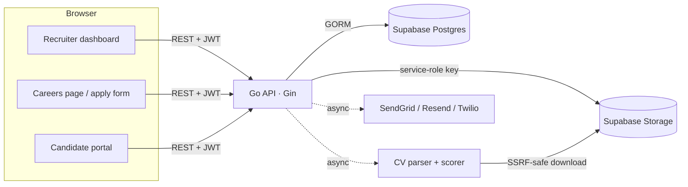

# ATS System

A multi-tenant applicant tracking system. Companies post jobs, candidates apply through a public careers page, and every CV is parsed and scored against the job's criteria so recruiters can shortlist faster.

**Backend:** Go · Gin · GORM · PostgreSQL (Supabase) &nbsp;|&nbsp; **Frontend:** Next.js 16 · React 19 · TypeScript · Tailwind CSS 4 · Zustand

## Features

- **Company workspaces**: each company registers its own account; data is scoped by `company_id` on every query.
- **Jobs**: create, edit, close and archive postings. Expired jobs close automatically at their deadline.
- **Public careers page and apply form**: candidates upload a CV (PDF/DOC/DOCX) or paste a link.
- **CV parsing and scoring**: text is extracted from PDF and DOCX files and scored on skills (with synonyms), experience, languages and job-description overlap. Scoring is local keyword matching; no external AI service is called.
- **Candidate search**: search every CV your company has received, including candidates from deleted jobs.
- **CRM**: private or shared recruiter notes, a talent pool, referral tracking and a per-candidate timeline.
- **Candidate portal**: applicants check their status with their email and application ID.
- **Notifications**: status emails via SendGrid or Resend, with optional Twilio SMS.
- **Embeddable dashboard**: an iframe-ready view of the recruiter dashboard for company websites.
- **Super-admin console**: platform-wide stats, companies and an audit log of every action.

## Architecture



The API is the only database client. It connects as the `postgres` role, and Row Level Security is enabled on every table with no policies, so the public Supabase keys cannot read or write anything.

## Security

- Company-admin and super-admin JWTs carry different audiences, so one can never be used as the other. `JWT_SECRET` is required and must be at least 32 characters.
- Sessions are HttpOnly cookies (`Secure; SameSite=None; Partitioned` so the embed works in third-party iframes). Writes must send an `X-ATS-Client` header, which cross-site pages can't do without passing CORS, so CSRF is blocked.
- Each request re-checks (cached 30s) that the admin still exists, the company isn't suspended and the password hasn't changed since the token was issued. Owners and recruiters have separate permissions.
- Every recruiter endpoint resolves records through `company_id`, so one company can't read or modify another company's data.
- Public endpoints accept only the fields an applicant may set; scores and statuses can't be injected.
- CV links are downloaded through a client that refuses private, loopback and link-local addresses (checked at connect time), with a 10 MB cap and timeouts.
- Uploads are checked by extension, file signature and size, then stored under random names in **private** buckets. The API returns an upload ID (never a URL); an application claims it exactly once within 24 hours, and unclaimed files are purged hourly. Recruiters open files through 5-minute signed links issued after a company check, and deleting an application deletes its files.
- New accounts must verify their email before signing in. Registration answers identically for new and existing emails, so it can't be used to discover accounts.
- Login, registration and public endpoints are rate-limited per IP. CORS is restricted to `ALLOWED_ORIGINS`.
- Every value placed in an email template is HTML-escaped.

## Getting started

### Prerequisites

Go 1.26+, Node.js 20.9+, the [Supabase CLI](https://supabase.com/docs/guides/cli), and a Supabase project (or Docker for a local one).

### 1. Database

The schema lives in [`supabase/migrations`](supabase/migrations), and [`supabase/seed.sql`](supabase/seed.sql) holds demo data.

**Hosted Supabase**

```bash
supabase link --project-ref <your-project-ref>
supabase db push            # applies the migrations, including the storage buckets
```

**Local Supabase (Docker)**

```bash
supabase start
supabase db reset           # applies the migrations, then seed.sql
```

The seed creates a demo company (`admin@acme.test`) and a super admin (`owner@ats.test`), both with the password `demo12345`.

**Existing databases** (created by the old GORM auto-migration): mark the base migrations as applied, then push. `20251201000300_align_legacy_schema.sql` fixes constraints, types and RLS in place without touching data.

```bash
supabase migration repair --status applied 20251201000000 20251201000100 20251201000200
supabase db push
```

Uploads go through the API with `SUPABASE_SERVICE_ROLE_KEY`, so once that backend is deployed, the old anonymous storage policies can be dropped:

```sql
drop policy if exists "Allow public uploads to resumes" on storage.objects;
drop policy if exists "Allow public uploads to portfolios" on storage.objects;
drop policy if exists "Allow public reads from resumes" on storage.objects;
drop policy if exists "Allow public reads from portfolios" on storage.objects;
```

### 2. Backend

```bash
cd backend
cp .env.example .env        # fill in DATABASE_URL, JWT_SECRET, SUPABASE_URL, SUPABASE_SERVICE_ROLE_KEY
go run .
```

The API listens on `http://localhost:8080`; `GET /health` returns `{"status":"ok"}`.

### 3. Frontend

```bash
cd frontend
cp .env.local.example .env.local
npm install
npm run dev
```

Open `http://localhost:3000`.

## Environment variables

| Variable | Required | Description |
|---|---|---|
| `DATABASE_URL` | yes | Supabase Postgres connection string: session pooler (port 5432) or direct. Live chat uses `LISTEN`, which the transaction pooler (6543) doesn't support |
| `JWT_SECRET` | yes | At least 32 random characters |
| `SUPABASE_URL` | for uploads | `https://<ref>.supabase.co` |
| `SUPABASE_SERVICE_ROLE_KEY` | for uploads | Used server-side only, to write to Storage |
| `FRONTEND_URL` | no | Used in email links. Default `http://localhost:3000` |
| `ALLOWED_ORIGINS` | no | Comma-separated CORS origins. Defaults to `FRONTEND_URL` |
| `TRUSTED_PROXIES` | no | Proxy IPs/CIDRs whose `X-Forwarded-For` is trusted |
| `APP_MODE` | no | `production` enables release mode and quieter logs |
| `EMAIL_PROVIDER` | no | `sendgrid` (default), `resend` or `smtp` |
| `SENDGRID_API_KEY`, `SENDGRID_FROM_EMAIL` | for SendGrid | |
| `RESEND_API_KEY`, `RESEND_FROM_EMAIL` | for Resend | |
| `SMTP_HOST`, `SMTP_PORT`, `SMTP_USERNAME`, `SMTP_PASSWORD`, `SMTP_FROM` | for SMTP | e.g. Gmail: `smtp.gmail.com`, `587`, your address, an app password |
| `SMS_PROVIDER`, `TWILIO_*` | no | Set `SMS_PROVIDER=twilio` to enable SMS |
| `COOKIE_SECURE` | no | Set `false` only for plain-http local development |
| `CLAMAV_ADDR` | recommended | clamd address (e.g. `localhost:3310`) to virus-scan uploads; when set, unscannable uploads are refused |
| `SAFEPAY_ENV` | for billing | `sandbox` (default) or `production` |
| `SAFEPAY_PUBLIC_KEY`, `SAFEPAY_SECRET_KEY` | for billing | From the Safepay dashboard (Developers › API keys) |
| `SAFEPAY_WEBHOOK_SECRET` | for billing | Shared secret of the webhook endpoint pointing at `/api/webhooks/safepay` |

The frontend reads `NEXT_PUBLIC_API_URL`, `NEXT_PUBLIC_FRONTEND_URL` and `NEXT_PUBLIC_APP_MODE`.

## API overview

| Area | Endpoints |
|---|---|
| Auth | `POST /api/auth/{register,login,logout,forgot-password,reset-password,verify-email,verify-email/resend}`, `GET /api/auth/me`, `GET /api/auth/invites`, `POST /api/auth/invites/accept`, `POST /api/super-admin/{login,logout}` |
| Public | `GET /api/jobs/public/:companyId`, `GET /api/public/jobs/:id`, `GET /api/public/sitemap`, `POST /api/applications`, `POST /api/upload/cv`, `POST /api/upload/portfolio` |
| Candidate portal | `POST /api/candidate/status`, `POST /api/candidate/messages`, `POST /api/candidate/messages/send`, `POST /api/candidate/stream-token`, `GET /api/candidate/events` (SSE) |
| Live chat | `GET /api/events` (SSE, company-scoped), `GET /api/messages/unread-summary` |
| Jobs | `GET/POST /api/jobs`, `GET/PUT/DELETE /api/jobs/:id` |
| Applications | `GET /api/applications`, `PUT /api/applications/:id/{shortlist,advance,reject,reopen}`, `POST /api/applications/:id/track-cv-view`, `GET /api/applications/:id/files/{resume,portfolio}`, `DELETE /api/applications/:id`, `POST /api/applications/bulk-delete`, `GET/POST /api/applications/:id/messages` |
| Scoring | `POST /api/applications/ai-shortlist`, `POST /api/applications/ai-shortlist-batch` |
| Candidates | `POST /api/candidates/search`, `GET /api/candidates/:id`, `POST /api/candidates/manual`, `POST /api/candidates/reparse-all`, `POST /api/candidates/:id/reparse` |
| CRM | `/api/crm/notes`, `/api/crm/talent-pool`, `/api/crm/applications/:id/{notes,referral,timeline}` |
| Super admin | `GET /api/super-admin/{stats,companies,activity-logs}`, `PUT /api/super-admin/companies/:id` |
| Activity | `GET /api/activity-logs` |
| Dashboard | `GET /api/dashboard/stats` |
| Team (owners) | `GET /api/team`, `POST/DELETE /api/team/invites[/:id]`, `PUT /api/team/members/:id/role`, `DELETE /api/team/members/:id` |
| Billing | `GET /api/billing`, `POST /api/billing/checkout` (owners), `POST /api/billing/payments/:id/confirm`, `POST /api/webhooks/safepay` |

## Tests

```bash
cd backend && go test ./...
cd frontend && npm run lint && npm run typecheck && npm run build

# End-to-end, against local Supabase with the seed loaded and the API running:
./scripts/smoke-test.sh                 # add SMOKE_CLAMAV=1 when the API has CLAMAV_ADDR set
```

The backend tests cover token audience separation, SSRF blocking, CV parsing and scoring, and rate limiting. CI runs all of the above on every push.

## Project structure

```
backend/
  config/       env and database setup
  controllers/  HTTP handlers
  middleware/   auth and rate limiting
  models/       GORM models
  routes/       route table
  services/     CV parsing, storage, email, SMS, audit log
  utils/        JWT
frontend/
  app/          Next.js App Router pages (admin, embed, super-admin, public)
  components/   shared UI (job form, application modals, toasts)
  lib/          typed API client and auth store
supabase/
  migrations/   schema, indexes, RLS and storage buckets
  seed.sql      demo data
```

## License

[MIT](LICENSE)
